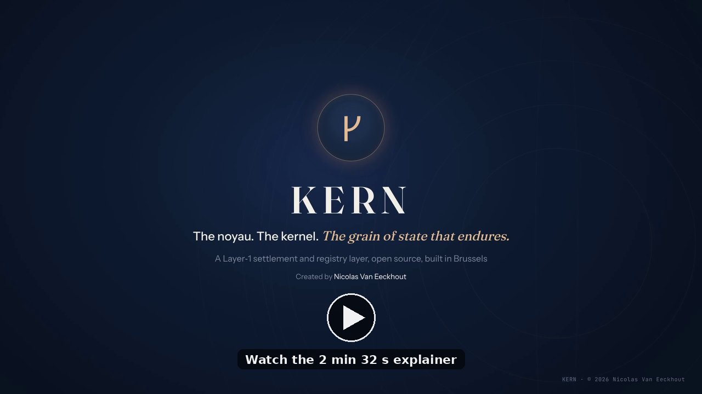
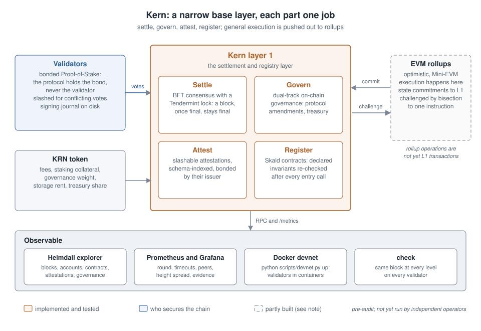
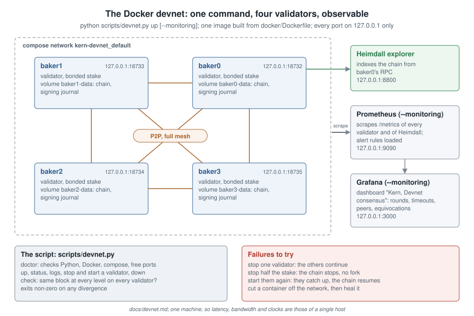

# KERN

[](https://doi.org/10.5281/zenodo.24046903)

> **⚠ Notice.** This is pre-audit software, provided "as is" without warranty. The author accepts no liability for any deployment, financial loss, or regulatory consequence arising from use of this code. Discussion of EU regulation is informational, not a compliance assurance. **Read [`docs/disclaimer.md`](docs/disclaimer.md) before using.**

> *The noyau. The kernel. The grain of state that endures.*

<p align="center">
  <a href="https://github.com/user-attachments/assets/c5c4a092-de52-4082-a11a-9b4859b6a52c" title="Watch the Kern explainer (2 min 32 s)"></a>
  <br>
  <sub><b>Kern in 2 min 32 s</b>: what the chain is for, how it reaches finality, and where it stands. Click the image to play it in your browser; full quality file (1080p, 19 MB): <a href="kern_site/media/kern-explainer.mp4"><code>kern_site/media/kern-explainer.mp4</code></a>.</sub>
</p>

**Kern** is a Layer-1 blockchain protocol that combines EVM tooling and developer-ecosystem compatibility with native on-chain governance, formal verifiability, and bonded Proof-of-Stake with delegation. Smart contracts are written in **Skald**, a small statically typed language (scalar types `int`, `bool`, `string`, `address`; no recursion, no loops) with declared invariants that the runtime re-checks after every entry call.

**Bonded Proof-of-Stake** means that the KRN securing the chain are locked in the protocol while they do so. Validators bond their own stake, and holders who do not run a node can delegate by bonding KRN to a validator; the protocol holds the bond, never the validator. A bond gives consensus weight and a share of rewards, can be slashed if its validator signs conflicting votes, and returns to its owner only after an unbonding period. There is no derivative token. Unlike liquid staking, bonded KRN cannot be spent while they secure the chain. Details: [`docs/staking.md`](docs/staking.md).

> **Status.** Kern is a Layer-1 protocol with a Python reference implementation, at devnet stage; no public network is in operation. The repository's `genesis.json` is a devnet file whose keys are public placeholders. Nothing here has been professionally audited, and nothing here has monetary value (see [docs/disclaimer.md](docs/disclaimer.md)).



*Figure 1 (`docs/figures/architecture.svg`, original). The validators secure the layer 1 with bonded stake; the chain settles, governs, attests and registers; EVM rollups commit to it and can be challenged; Heimdall, Prometheus and Grafana make it observable. Pre-audit, and not yet run by independent operators.*

This repository is the **v1.1 release candidate** — building on the v1.0-rc audit-frozen foundation with **slashable attestations** as a new L1 primitive, three **tokenized-securities Skald templates** for the EU securities regime — MiFID II / Prospectus Regulation / AIFMD, *not* MiCA, which excludes financial instruments under Art. 2(4) (startup equity, institutional fund, real estate; see [docs/sto-mica.md](docs/sto-mica.md)), **public goods funding primitives** (Quadratic Funding + Retroactive PGF), an **oracle network** (generic data + DeFi prices + schema marketplace), **ZK-claims** for privacy-preserving attestations (a Groth16 verifier over BN254 against registered verifier keys; no circuits, trusted setup or prover are shipped), and **Heimdall** — the official block explorer + monitoring stack that surfaces the institutional-legibility features Kern was built to support. See [docs/v11rc-changes.md](docs/v11rc-changes.md) for the full vertical and [docs/setup-heimdall-operator.md](docs/setup-heimdall-operator.md) for the explorer.

The v1.0-rc foundation includes: the Skald language with static type checker, a multi-validator BFT consensus engine, an optimistic rollup framework with a multi-frame Mini-EVM and bisection-based fraud proofs, **bonded PoS delegation (no LST derivative; delegated KRN are locked and slashable, with an unbonding period)**, **EVM Yellow Paper-compliant gas metering in the rollup Mini-EVM** (the L1 native layer uses a flat per-transaction fee and a non-recursive, loop-free Skald execution model that terminates by construction — see [docs/skald-language.md](docs/skald-language.md), with an optional governance-gated [fee floor + per-block size cap](docs/fee-floor.md) that is off by default), **real BN254 pairing via py_ecc**, and a complete on-chain governance system with slashing.

The genesis distribution is specified: **100 000 000 KRN** genesis supply, broad public distribution (70% public sale / 10% founder vested 4 years / 14% Foundation / 3% contributors / 2% validator bootstrap / 1% bootstrap validator stake), and a documented **API stability spec** declaring what's frozen at v1.0. The distribution is a design, not a launched economy: no sale has taken place, and a mainnet genesis can only be built from real multisig keys in a separate ceremony.

---

## 📋 Start here

| Document | What it is |
|----------|------------|
| [**Executive Summary**](docs/executive-summary.md) | The 5-minute pitch. Value proposition, differentiation, use cases, roadmap. **Read this first.** |
| [Whitepaper](docs/whitepaper.md) | Technical long-form: design principles, architecture, governance |
| [Tokenomics](docs/tokenomics.md) | KRN token economy: supply, distribution, sinks, governance |
| [**Staking & delegation**](docs/staking.md) | **Bonded PoS delegation: how it works, how to delegate** |
| [Contributors program](docs/contributors-program.md) | Three funding channels: genesis pool, Foundation, on-chain treasury |
| [Use cases](docs/use-cases.md) | Six target application domains, in detail |
| [Naming and symbolism](docs/naming-and-symbolism.md) | Glossary explaining Kern, Skald, Heimdall, network names, and design runes |
| [**Disclaimer**](docs/disclaimer.md) | **No warranty, no liability, no professional advice — read before using.** |
| [Legal audit](docs/legal-audit.md) | Standing diligence report: plagiarism, attribution, trademark, defamation, regulatory representation risks |

## 🛠️ Build & run

| Document | What it is |
|----------|------------|
| [Running a node](docs/running-a-node.md) | Single-node setup and 3-node local network |
| [**Heimdall — explorer + monitoring**](docs/setup-heimdall-operator.md) | **The official block explorer (FastAPI + SQLite indexer + Prometheus metrics) surfacing the v1.1-rc verticals** |
| [Architecture](docs/architecture.md) | Component-by-component map of the codebase |
| [API reference](docs/api.md) | The RPC surface |
| [**API stability spec**](docs/api-stability.md) | What's frozen, stable, beta — for downstream code |

## ⚙️ Protocol details

| Document | What it is |
|----------|------------|
| [Consensus](docs/consensus.md) | Three-phase BFT consensus — the single-validator view |
| [Multi-validator BFT](docs/bft.md) | The full 3-phase protocol: propose / pre-endorse / endorse |
| [Consensus on the wire](docs/consensus-wire.md) | How the BFT protocol travels over P2P: message kinds, quorum verification, sync — the normative spec for kern-go |
| [Cryptographic inventory](docs/cryptographic-inventory.md) | Every primitive Kern uses, what a quantum computer would break, and the plan for hybrid signatures from genesis. No part of Kern is post-quantum today. |
| [Skald language](docs/skald-language.md) | Grammar, semantics, examples |
| [Skald static typing](docs/typecheck.md) | The compile-time type checker |
| [EVM rollups](docs/rollups.md) | Optimistic Smart Rollup framework |
| [EVM fraud proofs](docs/evm-fraud-proofs.md) | Mini-EVM, bisection, single-step verifier |
| [Forced inclusion](docs/forced-inclusion.md) | Censorship-resistance mailbox |
| [Adaptive issuance](docs/adaptive-issuance.md) | Block rewards with self-stabilizing emission |
| [Merkle trie](docs/merkle-trie.md) | Binary trie + light-client proofs |
| [Multi-frame EVM](docs/multi-frame-evm.md) | CALL / STATICCALL / DELEGATECALL / CREATE / precompiles |
| [Governance](docs/governance.md) | Two-track on-chain governance, end-to-end |
| [**Roadmap**](docs/roadmap.md) | **Three-track plan: code, networks, operations** |
| [v0.4 changes](docs/v04-changes.md) | What was new in v0.4 |
| [v0.5 changes](docs/v05-changes.md) | What was new in v0.5 |
| [v0.6 changes](docs/v06-changes.md) | What was new in v0.6 |
| [v0.7-v0.9 changes](docs/v07-v08-v09-changes.md) | BN254 + dynamic gas + voting + observability + fuzzing |
| [v1.0-rc changes](docs/v10rc-changes.md) | Genesis 100M + PoS delegation (bonded since Phase D) + real pairing + API freeze |
| [**v1.1-rc changes**](docs/v11rc-changes.md) | **Slashable attestations + STO securities templates + public goods funding + oracle network + ZK-claims (this version)** |
| [Pre-mainnet checklist](docs/pre-mainnet-checklist.md) | Everything that must complete before Midgard launches |

---

## What's in this repository

This is a **working reference implementation** in Python: **~33 000 lines of code, ~70 markdown specifications, 1137 tests passing.**

```
kern/
├── kern/                       # Core protocol (L1)
│   ├── crypto.py               # Ed25519, blake2b-256, base58check
│   ├── transaction.py          # 11 OpKinds incl. v1.1-rc attestations
│   ├── block.py                # BlockHeader, Block, merkle root
│   ├── chain.py                # State machine + governance tick + delegation
│   ├── consensus.py            # propose_block governance-aware
│   ├── bft.py                  # Multi-validator BFT
│   ├── network.py              # asyncio P2P gossip
│   ├── rpc.py                  # JSON-over-HTTP RPC + /metrics + /chain/governance
│   ├── storage.py              # SQLite-backed persistence
│   ├── node.py                 # Process lifecycle, CLI
│   ├── rollup.py               # Optimistic rollup
│   ├── forced_inclusion.py     # Censorship-resistance mailbox
│   ├── issuance.py             # Adaptive issuance + split_validator_reward
│   ├── trie.py                 # Binary Merkle trie + light-client proofs
│   ├── governance.py           # Two-track + quadratic + delegated + equivocation
│   ├── observability.py        # JSON-line logs + Prometheus metrics
│   ├── attestation.py          # ★ v1.1-rc: slashable attestation primitive
│   ├── zk_claims.py            # ★ v1.1-rc: Groth16 ZK-claim infrastructure
│   ├── fuzzing.py              # Property-based fuzzers
│   ├── evm/
│   │   ├── opcodes.py
│   │   ├── vm.py               # Dynamic gas wired in step()
│   │   ├── bisection.py
│   │   ├── frames.py
│   │   ├── bn254.py            # Real pairing via py_ecc
│   │   └── dynamic_gas.py      # Yellow Paper gas cost model
│   └── skald/                  # Skald language + 10 example contracts
├── kern_explorer/              # ★ Heimdall — block explorer + monitoring stack
│   ├── client.py               # Async RPC client
│   ├── db.py                   # SQLite indexer schema
│   ├── indexer.py              # Background chain follower (asyncio) +
│   │                           #   compute_vertical_summary() for STO / Oracle / PGF
│   ├── metrics.py              # Prometheus exporter (~36 metrics)
│   ├── app.py                  # FastAPI app: 19 HTML routes + 12 JSON API
│   ├── templates/              # 18 Jinja2 templates (Tailwind CDN + Alpine.js,
│   │                           #   sortable tables, pagination, ARIA accessibility)
│   └── monitoring/             # 7 Grafana dashboards JSON + AlertManager rules +
│                               #   docker-compose for the full Heimdall + Prometheus +
│                               #   AlertManager + Grafana stack
├── docs/                       # ~70 markdown specs and guides
├── networks/
│   └── devnet_bootstrap.py
├── scripts/
│   ├── generate_keys.py
│   ├── build_genesis.py
│   ├── build_v1_genesis.py     # v1.0 distribution: 70/10/14/3/2/1
│   └── kern_wallet.py
├── tests/                      # 1137 tests, none skipped
├── docker/
├── genesis.json                # 100M KRN, Ethereum-style distribution
└── genesis_vesting.json        # Off-chain vesting schedules
```

★ = added or substantially extended in v1.1-rc.

## Genesis economy at a glance

| Pool | KRN | % | Vesting |
|---|---:|---:|---|
| Public sale | 70 000 000 | 70% | Liquid at genesis |
| Founder (Nicolas Van Eeckhout) | 10 000 000 | 10% | 1-year cliff + 4-year linear |
| Foundation | 14 000 000 | 14% | Strategic ops, legal-entity multisig |
| Early contributors pool | 3 000 000 | 3% | 6-month cliff + 3-year linear |
| Validator bootstrap | 2 000 000 | 2% | Released over 1 year |
| Bootstrap baker | 1 000 000 | 1% | Genesis validator stake (bonded at genesis) |
| **Total** | **100 000 000** | **100%** | |

> **Allocation notes (reconcile before genesis).** This table now matches the executable [`genesis.json`](genesis.json), which is the source of truth. Two items still need a decision before the genesis ceremony: (1) the Foundation pool (14M) currently shares an address with the on-chain **treasury** — for clean accounting and audit these should be **separate addresses**; (2) the **Bootstrap baker** holds the only genesis validator stake (1M) and is therefore a single point of control at launch — the validator-onboarding plan in [`docs/setup-validator.md`](docs/setup-validator.md) should bring independent validators in as early as possible. Earlier drafts described a flat 70/10/15/3/2 split; the 1M baker line was carved out of the Foundation share, which is why Foundation reads 14% here.

See [`docs/tokenomics.md`](docs/tokenomics.md) §4 for full rationale and [`docs/contributors-program.md`](docs/contributors-program.md) for the contributor compensation structure.

## Quick start

Requires Python 3.11+.

```bash
git clone https://github.com/vaneeckhoutnicolas/kern.git
cd kern
pip install -r requirements.txt   # includes pynacl, aiohttp, py_ecc

# Generate a baker keypair
python scripts/generate_keys.py --out keys/baker1.json

# Initialize a node from genesis
python -m kern.node init --genesis genesis.json --data-dir ./data/node1

# Start the node (with the baker)
python -m kern.node start \
    --data-dir ./data/node1 \
    --rpc-port 8732 --p2p-port 9732 \
    --baker-key keys/baker1.json \
    --block-time 1.0
```

Query the running node:

```bash
curl http://localhost:8732/chain/head
curl http://localhost:8732/chain/health
curl http://localhost:8732/chain/balance/<some kn1... address>
curl http://localhost:8732/chain/governance     # active proposals + activations
curl http://localhost:8732/metrics              # Prometheus format
```

Run the test suite:

```bash
pytest tests/
# 1137 passed in about 2 minutes (the multi-process consensus tests start real nodes)
```

### A multi-node devnet in one command (Docker)

```bash
python scripts/devnet.py doctor            # checks Python and Docker, offers to install what is missing
python scripts/devnet.py up                # 4 validators in containers + Heimdall on :8800
python scripts/devnet.py check             # every validator holds the same block at every level
python scripts/devnet.py up --monitoring   # + Prometheus (:9090) and Grafana (:3000)
python scripts/devnet.py down --reset
```

Each validator runs in its own container with its own data and signing journal, over a real network; stop one, stop two, cut one from the network, and watch the chain continue, stop without forking, and recover. Details: [`docs/devnet.md`](docs/devnet.md).



*Figure 2 (`docs/figures/devnet.svg`, original). Four validator containers, each with its own volume and signing journal, in a full peer to peer mesh; Heimdall reads baker0; Prometheus and Grafana with --monitoring. Every port is published on 127.0.0.1 only.*

### Open the block explorer (Heimdall)

In a second terminal, start **Heimdall** — Kern's official block explorer and monitoring stack — pointing at your local node:

```bash
pip install -e ".[explorer]"     # one-time install of explorer extras
heimdall                          # starts the FastAPI app on :8800
```

Open `http://127.0.0.1:8800` in your browser. You will see the live chain head, recent blocks, recent transactions, validators, originated contracts (classified by detected Skald template), the slashable attestation registry, and the governance state. Search by block level, transaction hash, account address, or attestation ID.

Programmatic and monitoring endpoints:

```bash
curl http://localhost:8800/api/stats          # JSON chain summary
curl http://localhost:8800/health             # JSON health probe (node + indexer)
curl http://localhost:8800/metrics            # Prometheus text format
```

Full operator documentation: [`docs/setup-heimdall-operator.md`](docs/setup-heimdall-operator.md).

For a multi-node local network, see [`docs/devnet.md`](docs/devnet.md) (Docker, one command) or [`docs/running-a-node.md`](docs/running-a-node.md) (by hand).

## The wallet CLI

A minimal reference wallet CLI ships in `scripts/kern_wallet.py`. It demonstrates how to build, sign, and inject every kind of transaction:

```bash
# Generate a new keypair
python scripts/kern_wallet.py keygen --out ~/my-wallet.json

# Inspect and balance
python scripts/kern_wallet.py inspect ~/my-wallet.json
python scripts/kern_wallet.py balance ~/my-wallet.json

# Read the chain
python scripts/kern_wallet.py head
python scripts/kern_wallet.py validators
python scripts/kern_wallet.py governance

# Transfer KRN
python scripts/kern_wallet.py transfer ~/my-wallet.json \
    --to kn1recipient... --amount 10.5

# Bond KRN to a validator (locked until the unbonding period ends)
python scripts/kern_wallet.py delegate ~/my-wallet.json \
    --validator kn1baker... --amount 100

# Vote on a governance proposal (validators only)
python scripts/kern_wallet.py vote ~/my-wallet.json \
    --proposal abc123 --track protocol --vote yes

# Submit slashing evidence (anyone — earns 10% of slashed amount)
python scripts/kern_wallet.py slash ~/my-wallet.json \
    --proposal abc123 --equivocator kn1misbehaving...
```

Set `KERN_RPC=<url>` to point at a public RPC instead of localhost.

## Delegate KRN to a validator

```python
from kern.crypto import KernKeypair
from kern.transaction import make_delegate_stake
import urllib.request, json

# Load delegator key
alice = KernKeypair.from_seed(bytes(32))   # or load from file

# Build delegation tx
tx = make_delegate_stake(
    sender_kp=alice,
    validator="kn1baker_address_here",   # validator's address
    nonce=0,
    amount=100 * 1_000_000,              # mukrn to bond (100 KRN)
    chain_id="kern-devnet-placeholder",  # read it from /chain/health
)

# Inject via RPC
body = json.dumps(tx.to_dict()).encode()
req = urllib.request.Request(
    "http://localhost:8732/chain/inject_transaction",
    data=body, headers={"Content-Type": "application/json"},
)
print(urllib.request.urlopen(req).read().decode())
```

The `amount` passed to `make_delegate_stake` is bonded: it leaves Alice's spendable balance, counts toward the validator's consensus weight from the next epoch boundary, earns rewards proportionally minus the validator's commission (10% default), and is slashed with the validator. To stop: `make_undelegate_stake(alice, nonce=...)`; the validator loses that weight at once, and the bond stays locked for the unbonding period (86 400 blocks by default), still slashable for offences committed before the undelegation, then returns to her balance. No LST derivative.

See [`docs/staking.md`](docs/staking.md) for full mechanics.

## Try the fraud-proof protocol

```python
from kern.evm import execute, run_full_bisection, single_step_verify, Op, ExecutionTrace

# Run a small EVM program
code = bytes([
    Op.PUSH1, 5, Op.PUSH1, 7, Op.ADD,
    Op.PUSH1, 2, Op.MUL,
    Op.STOP,
])
honest = execute(code, gas=100_000)
print(f"Result: {honest.states[-1].stack}")           # [24]
print(f"Steps:  {honest.n_steps}")                     # 5

# Sequencer corrupts the final commitment...
fake_commitments = list(honest.commitments)
fake_commitments[-1] = b"\xee" * 32
fake_seq = ExecutionTrace(states=honest.states, commitments=fake_commitments)

# ... challenger catches them via bisection
state, log = run_full_bisection(fake_seq, honest)
print(f"Fraud isolated to step {state.step_disagreement()}")
print(f"L1 transactions needed: {len(log)}")
```

## Try a real BN254 pairing (for zkSNARK verifiers)

```python
from kern.evm.bn254 import bn_pairing_precompile, PY_ECC_AVAILABLE
print(f"Real pairing active: {PY_ECC_AVAILABLE}")

# EIP-197 calldata: pair (G1, G2) + pair (-G1, G2). The product should equal 1.
G1_X, G1_Y = 1, 2
G2_X_R = 10857046999023057135944570762232829481370756359578518086990519993285655852781
G2_X_I = 11559732032986387107991004021392285783925812861821192530917403151452391805634
G2_Y_R = 8495653923123431417604973247489272438418190587263600148770280649306958101930
G2_Y_I = 4082367875863433681332203403145435568316851327593401208105741076214120093531
P = 21888242871839275222246405745257275088696311157297823662689037894645226208583

g2 = (G2_X_I.to_bytes(32, "big") + G2_X_R.to_bytes(32, "big")
      + G2_Y_I.to_bytes(32, "big") + G2_Y_R.to_bytes(32, "big"))
calldata = (
    G1_X.to_bytes(32, "big") + G1_Y.to_bytes(32, "big") + g2
    + G1_X.to_bytes(32, "big") + (P - G1_Y).to_bytes(32, "big") + g2
)
result = bn_pairing_precompile(calldata)
print(f"Pairing identity holds: {result[-1] == 1}")    # True
```

---

## Status & roadmap

| Phase | Scope | Status |
|---|---|---|
| v0.1 | Single-baker chain + Skald interpreter | ✅ |
| v0.2 | Multi-validator BFT + Static Skald + Rollup framework | ✅ |
| v0.3 | Mini-EVM + bisection + forced inclusion + adaptive issuance | ✅ |
| v0.4 | Issuance live in production + Merkle trie + EVM extensions | ✅ |
| v0.5 | Governance live + trie swap-in + multi-frame EVM | ✅ |
| v0.6 | Governance via transactions + apply_block wiring + bonds | ✅ |
| v0.7 | BN254 scaffolding + dynamic gas constants (Yellow Paper) | ✅ |
| v0.8 | Quadratic + delegated voting + equivocation tracking | ✅ |
| v0.9 | Observability + property-based fuzzing + devnet bootstrap | ✅ |
| **v1.0-rc** | Genesis 100M + PoS delegation (bonded since Phase D) + dynamic gas wired + real BN254 + slashing tx + API freeze | ✅ |
| **v1.1-rc** | **Slashable attestations + STO securities templates + QF/RPGF + oracle network + ZK-claims** | **✅** |
| **v1.1-rc Phase A** | **Hardening: consensus on the wire (verified > 2/3 quorum on every networked block), strict ingress decoding, integer-only issuance, periodic snapshots + replay, catch-up sync, mypy clean** | **✅** |
| **v1.1-rc Phase B** | **Fixes from two independent external reviews (not a professional security audit): exception boundary, attestation bond unbonding, current level, single delegation truth, chain_id enforcement, genesis checks, real Groth16 verifier, executed-step rollup challenges, portable precompiles ([details](docs/phase-b-changes.md))** | **✅** |
| **v1.1-rc Phase C** | **Consensus hardening from a third external review: quorum certificates bound to the proposed block, on-chain slashing of consensus equivocation, one effective validator set per epoch ([details](docs/phase-c-changes.md))** | **✅** |
| **v1.1-rc Phase D** | **Consensus weight backed by slashable collateral: bonded own stake and delegations with an unbonding period, evidence window, bounded BFT state ([details](docs/phase-d-changes.md))** | **✅** |
| **v1.1-rc Phase E** | **Undelegation lowers weight at once, slashing limited to exposed stake; consensus fork reproduced in a network harness and closed by a Tendermint-style lock and valid round with a persistent signing journal; crash recovery of the journal, the locked blocks and their pre-endorsement certificates, after review of the implementation; validated on the simulator and on real node processes on one machine, including crashes of a dominant validator and of the whole cluster ([details](docs/phase-e-changes.md), [design](docs/consensus-locking.md))** | **🟡 in progress (this version): multi-machine devnet** |
| kern-go | Go client in a sibling repo — this repo remains the executable specification; kern-go becomes the operator reference after differential testing ([details](docs/roadmap.md)) | 🔵 announced |
| v1.0 | First stable release after audit cycle 1 | 🔵 |
| Yggdrasil testnet | Public testnet, permissionless validators | 🔵 |
| Midgard mainnet | Production launch with 100M KRN distribution | 🔵 |

See [`docs/roadmap.md`](docs/roadmap.md) for the full three-track plan (code releases, networks, operational milestones).

This is a **reference implementation and protocol specification**, not yet a production network. Kern is a Layer 1 by design (own consensus, settlement, execution and native token, no dependency on another chain); it is not yet a Layer 1 network in operation (no multi-machine devnet with independent validators, no public testnet). It is intended for protocol research, education, prototyping rollup applications, and as the foundation of the upcoming Yggdrasil testnet and Midgard mainnet. Do not use it to secure real value before audit cycle 1 completes.

## After v1.1-rc — what's next

**Multi-validator consensus is not yet proven in the field.** Phase E found that the engine could finalize two blocks at the same level under message delay alone, and fixed it with a Tendermint-style lock and valid round ([consensus-locking.md](docs/consensus-locking.md)). The fix passes every scenario of the network simulator, including one quarter of the stake byzantine, and runs on real node processes on one machine, including crashes of a validator holding 90% of the stake and of all validators at once, followed by a restart. It has not run on several machines with independent operators and has not been audited; no public testnet should start before both. Beyond that, what remains is mostly execution work that cannot be solved by writing more code. See [`docs/post-code-roadmap.md`](docs/post-code-roadmap.md) for the detailed plan. In summary:

| Phase | What | Indicative time | Indicative cost |
|---|---|---|---:|
| **1. Foundation incorporation** | Estonian Foundation (Sihtasutus): e-Residency, counsel, board, statutes, registry, bank, multisigs | ~2-3 months | €20-40k |
| **2. Audit cycle 1** | Professional smart-contract audit (Trail of Bits / OtterSec / Hashlock / RV / ChainSec) | 2-3 months | €100-200k |
| **3. Yggdrasil testnet** | Public testnet with 5-10 validators; 60-day stability validation | ~2 months (parallel) | €15-30k |
| **4. Audit remediation + cycle 2** | Apply findings; re-audit | ~2 months | €50-80k |
| **5. Public sale** | Securities counsel, KYC, staged sale (private → strategic → public) | ~1 month | €30-50k + counsel |
| **6. Midgard mainnet launch** | Genesis ceremony, block 1, KRN distribution | ~2 weeks | €10-30k |
| **Total realistic** | | **9-15 months** | **~€275-510k operational** |

**Status of internal security review**: a self-conducted security review of the v1.1-rc additions surfaced and fixed 7 vulnerabilities (2 Critical, 2 Major, 2 Medium, 1 Minor) — see [`docs/security-review-v11rc.md`](docs/security-review-v11rc.md). This is INPUT to the professional audit, not a substitute for it.

The professional audit (Phase 2) is **mandatory before mainnet** and is the gating quality-assurance step. Until it completes, Kern remains a reference implementation.

For specific operational guides on each phase, see [`docs/setup-foundation.md`](docs/setup-foundation.md), [`docs/setup-auditor.md`](docs/setup-auditor.md), [`docs/setup-validator.md`](docs/setup-validator.md), and [`docs/pre-mainnet-checklist.md`](docs/pre-mainnet-checklist.md).

## How to cite

If you use Kern, its reference implementation or its consensus design, please cite it. The metadata are in [`CITATION.cff`](CITATION.cff) (GitHub shows a "Cite this repository" button). The v1.1.0-rc2 edition is archived on Zenodo under the DOI [10.5281/zenodo.24046904](https://doi.org/10.5281/zenodo.24046904); the concept DOI [10.5281/zenodo.24046903](https://doi.org/10.5281/zenodo.24046903) always resolves to the latest archived version. Software Heritage archives the signed tag as [`swh:1:rel:5b23398b47c4585379011dc86a05635604c29df0`](https://archive.softwareheritage.org/swh:1:rel:5b23398b47c4585379011dc86a05635604c29df0) and its source tree as [`swh:1:dir:5e8448555a4e5e0cdfe9cfe5158a1d3d8b727ae7`](https://archive.softwareheritage.org/swh:1:dir:5e8448555a4e5e0cdfe9cfe5158a1d3d8b727ae7).

```bibtex
@software{van_eeckhout_kern,
  author  = {Van Eeckhout, Nicolas},
  title   = {Kern: a Layer-1 settlement and registry protocol with the Skald
             contract language (reference implementation)},
  version = {1.1.0-rc2},
  doi     = {10.5281/zenodo.24046904},
  url     = {https://github.com/vaneeckhoutnicolas/kern},
  license = {Apache-2.0}
}
```

Each later release is archived the same way; its version DOI is added here and to `CITATION.cff`.

## License

**Code: Apache License 2.0** — see [LICENSE](LICENSE) and the [NOTICE](NOTICE) file. **Documentation & whitepaper: CC-BY-SA-4.0** — see [LICENSE-DOCS.md](LICENSE-DOCS.md).

Apache-2.0 is a permissive license: you may use, modify, and redistribute Kern — including inside proprietary, closed-source products — with **no copyleft obligation** to open-source your own code. The conditions are the usual permissive ones: retain the copyright and license notices, include a copy of the license, state any significant changes you make, and pass along the `NOTICE` file. Apache-2.0 additionally grants an **express patent license** from contributors (and terminates it if you bring a patent suit over the work) — a meaningful protection for an L1 protocol.
