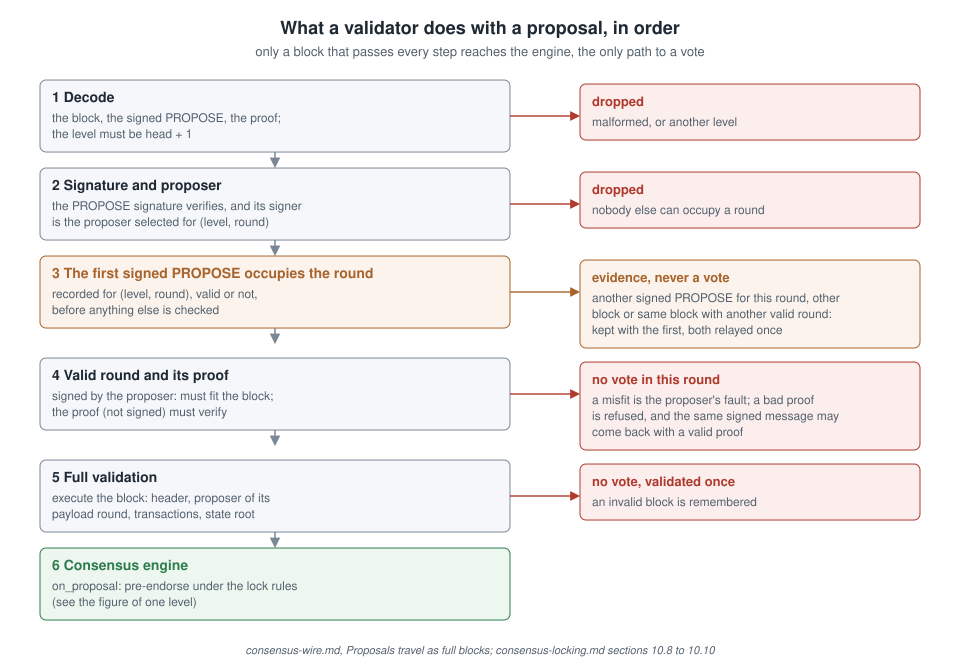
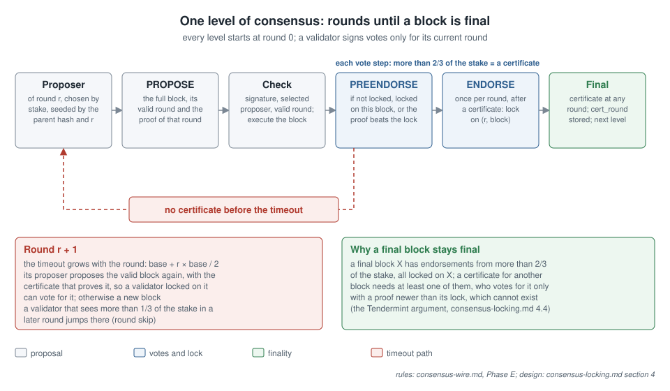
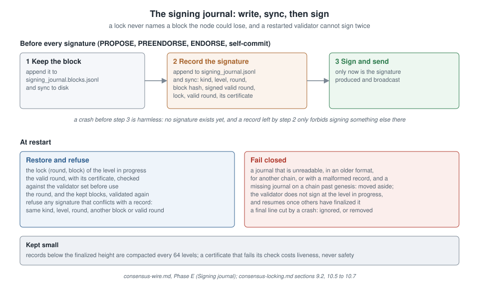

# Consensus on the wire

This document specifies how the three-phase BFT consensus (`kern/bft.py`)
travels over the peer-to-peer network (`kern/network.py`) and how the node
(`kern/node.py`) drives it. It is the normative reference for any second
client implementation (see `docs/go-port-breakpoints.md`).

Status: implemented in v1.1-rc Phase A hardening, with the lock and
valid round of Phase E (E1). Every block accepted by a live node,
self-baked, gossiped, or synced, is validated with `require_quorum=True`:
a cryptographically verified endorsement quorum of strictly more than 2/3
of validator stake, at the block's `cert_round`.

> **Safety status (Phase E).** Before E1, a verified quorum was not enough: under message delay alone, with every validator honest, round 0 could finalize block B on one node while round 1 finalized block C on the others. E1 adds the Tendermint lock and valid round ([consensus-locking.md](consensus-locking.md)), described in the section "Phase E: lock, valid round, signed proposals" below. It is validated on the network simulator (`tests/test_phase_e_consensus_harness.py`: no fork in any scenario, including one quarter of the stake byzantine) and on four real node processes on one machine (`tests/test_phase_e_multiprocess.py`). It has not yet run on several machines with independent operators, and has not been audited. No public testnet should start before both.

## Message kinds

Each peer connection is a length-prefixed (4-byte big-endian) JSON
message stream. Seven kinds exist:

| Kind          | Payload                          | Purpose                              |
|---------------|----------------------------------|--------------------------------------|
| `hello`       | `{"level": N}`                   | Sent by both sides on connect        |
| `proposal`    | `{"block", "proposal", "proof"}` | Candidate block, its signed PROPOSE message, and for a re-proposal the certificate that justifies it |
| `consensus`   | `{"msg": {...}}`                 | Signed PREENDORSE / ENDORSE          |
| `block`       | `{"block": {...}}`               | Finalized block carrying its quorum  |
| `transaction` | `{"tx": {...}}`                  | Mempool gossip                       |
| `get_blocks`  | `{"from": A, "to": B}`           | Catch-up sync request                |
| `blocks`      | `{"blocks": [{...}, ...]}`       | Catch-up sync response               |

Hardening caps at this layer: 16 MiB per message, 128 concurrent
connections, 512 blocks per sync reply. Malformed frames close the
connection; a handler error on one message is logged and does not kill
the connection.

All inner payloads are decoded by the strict typed `from_dict`
constructors (`Transaction`, `BlockHeader`, `Block`, `ConsensusMessage`,
`QuorumCertificate`),
which raise field-specific `ValueError`s on any type or bounds violation.
The network layer never interprets payloads itself.

## Proposals travel as full blocks

Proposals are broadcast on the `proposal` channel as an envelope:

```
{"block":    {... the full block, endorsements empty ...},
 "proposal": PROPOSE {level, round, block_hash, valid_round, validator, validator_pubkey, signature},
 "proof":    null, or a PREENDORSE certificate for block_hash at valid_round}
```

A validator only calls `BftEngine.on_proposal`, which may emit its
pre-endorsement, after these checks, in this order (`Node._on_proposal_msg`):

1. Everything decodes strictly; the block is for the next level; the
   PROPOSE message is for the same level and the block's hash.
2. The round is inside the engine window; the PROPOSE signature is valid
   and its signer is `select_proposer(parent_hash, validators, round)`.
3. `valid_round = -1` (a new payload): `header.payload_round == round`.
   `valid_round >= 0` (a payload proposed again):
   `header.payload_round <= valid_round < round`, and `proof` is a
   PREENDORSE certificate for this block at `(level, valid_round)` that
   verifies against the validator set.
4. Full validation of the block with
   `validate_and_apply(..., require_quorum=False)`: header signature,
   parent linkage, header proposer equal to
   `select_proposer(parent_hash, validators, payload_round)`, txs root,
   fee rules and state root.

The first signed PROPOSE seen for a (level, round), once its signature
and its proposer are checked (step 2), occupies that (level, round)
before step 3, and only it can go through step 4. The node remembers it
whether or not it passes steps 3 and 4. One exception: a proof that does
not verify is not signed by the proposer and a relay may have damaged it,
so the same signed PROPOSE arriving later with a valid proof still goes
on. Two PROPOSE messages are the same when what they sign is the same;
the bytes of the two signatures are not compared, since one statement
can be signed more than once. Any other signed PROPOSE for the same (level, round), for a
different block or for the same block with another valid round, is
never validated, kept or voted on, even when the first one was invalid:
the two signed PROPOSE messages are recorded as proposal equivocation
evidence, and both proposals are relayed once. A node that receives the
two through the relay keeps the first one it sees, valid or not, and
behaves the same way. A block that
fails step 4 is not validated again. Only a block that passed step 4
reaches the engine as a proposal it may vote on.

Bare PROPOSE messages on the `consensus` channel are dropped: no
validator ever pre-endorses a hash whose block it has not executed. Valid
proposals are re-gossiped, so a proposer that sends two different blocks
for one round to two halves of the network is seen by everyone.



*Figure 1 (`docs/figures/proposal-checks.svg`, original). Six checks before a vote is possible. The first signed PROPOSE occupies the round; any other signed PROPOSE for that round is kept as evidence and never voted on.*

## commits vs endorsements

A finalized block carries two signature lists, both made of
`"<kn1 address>:<base58 signature>"` entries in the ENDORSE message
schema, both verified by `bft.verify_commits` and counted together for
the quorum:

- `commits` — endorse-schema signatures known to the proposer **at
  proposal time**: the proposer's own self-endorsement, signed for the
  payload round. Phase E: the proposer signs it only when it holds more
  than two thirds of the consensus stake on its own (single-validator
  operation); with several validators `commits` is empty, because an
  endorsement signed before any pre-endorsement certificate would bypass
  the lock rules. Phase B: reward accounting does not read `commits` at
  all (see below).
- `endorsements` — the endorsement quorum certificate gathered **on the
  wire after** the header was signed, for the round `cert_round` (a body
  field, not hashed, never below `payload_round`). Excluded from the header hash and
  from reward accounting: including them in either would be circular,
  because endorsers sign the block hash, which covers the state root,
  which would then depend on the endorsement set. Entries are sorted for
  a deterministic encoding. Two honest nodes may store different (but
  overlapping) valid quorum sets for the same block; the block identity
  is the header hash, which is unaffected.

Verification (`chain.validate_and_apply` with `require_quorum=True`):
every entry is reconstructed as an ENDORSE `ConsensusMessage` over
`(level, round, block_hash)`, where `round` is `cert_round` for
`endorsements` and `payload_round` for `commits`, with the validator's
registered public key and its signature verified. Any malformed or forged
entry is a hard rejection. Duplicate addresses count once. The verified
stake must satisfy `stake * 3 > total_stake * 2`. The two lists are
counted together only when `cert_round == payload_round`; otherwise
`commits` must still verify, and `endorsements` alone must hold the
quorum, since a certificate is made of endorsements of one round.

Solo mode: a single validator holds 100% of stake, so its self-commit
alone satisfies the strict quorum — one schema, one verifier. The node
still routes that self-commit through its engine and signing journal
before showing the block (`BftEngine.adopt_self_commit`).

Known limitation, deliberate: the proposer is the sole rewarded endorser.
Phase B (audit 2, point 4) made this explicit in `_apply_block_rewards`:
it used to derive the endorser set from the addresses in `commits`
without verifying their signatures (signatures are checked only by the
quorum step, after the state root comparison), so a relay could add an
entry and change the reward split. Wire endorsers are quorum evidence
and do not earn endorsement rewards in this version. Moving endorsement rewards to
parent-block accounting (rewarding at level N+1 the endorsers of level
N, the standard resolution) is a consensus rule change tracked for a
future protocol version.

## Node flow

Proposer (its turn per `select_proposer(parent_hash, validators, round)`,
cadence `block_time`):

0. Before signing anything over a block, write it to
   `signing_journal.blocks.jsonl` and sync it (below, "Signing journal").
1. If the engine has a valid round for this level (it saw a
   pre-endorsement certificate for block X at `valid_round`) and the node
   holds X, propose X again with that `valid_round` and the certificate
   as `proof`. Otherwise build a new payload from the mempool
   (`propose_block` with `payload_round = round`; the mempool read is
   non-destructive).
2. Sign the PROPOSE message through the engine (`make_proposal`, which
   writes the signing journal first; a refusal skips the proposal).
3. Store the block in the pending map, broadcast the envelope.
4. Self-deliver to its own engine: `on_proposal` may emit its
   PREENDORSE, which loops through `_ingest_consensus` exactly like a
   wire message.

Every validator, on a valid proposal or consensus message:

1. Deduplicate by `(kind, level, round, validator, block_hash)`. For a
   valid proposal: keep its block on disk before the engine may sign,
   then count the endorsements its `commits` carry as ENDORSE votes of the
   payload round (the self-commit of a proposer holding the quorum alone).
2. Feed `BftEngine.on_message`; broadcast and self-ingest any outbound
   messages it returns.
3. Re-gossip newly seen wire messages for mesh propagation.
4. Try to finalize: if `find_endorse_qc(level, hash)` returns an
   endorsement certificate at any round for a pending block, set
   `endorsements` from it and `cert_round` to its round, then
   `chain.append(block, require_quorum=True)`, persist, purge included
   transactions from the mempool, prune engine state, broadcast the
   finalized block.

Followers (no validator key) skip the engine entirely and accept only
finalized blocks, which carry their quorum with them.

## Rounds and timeouts

Every level starts at round 0 (Phase E). Round `r` lasts
`round_timeout(base, r) = base + r * base / 2`, with
`base = max(2 s, 4 × block_time)`. The node moves to a later round when
the round times out, when validators holding more than one third of the
stake have already voted in a later round (`round_to_skip_to`), or when
it accepts a valid proposal for a later round within the engine window
(8 rounds). Rounds never move backwards inside a level. Nothing about the
next level is derived from the round at which a block was finalized.
Equivocation (two conflicting signed votes of the same kind at the same
level and round) is slashable evidence (`SlashingEvidence`); two
different PROPOSE messages from one proposer for one (level, round) are
kept as `ProposalEquivocation` evidence, not slashable yet.



*Figure 2 (`docs/figures/consensus-level.svg`, original). Each level starts at round 0. More than two thirds of the stake of pre-endorsements form a certificate and lock the validators; more than two thirds of endorsements finalize the block. Without a certificate the round times out, the next round lasts longer, and its proposer offers the locked block again with its proof.*

## Catch-up sync

Both sides of a new connection send `hello` with their head level. A node
that learns of a higher peer level — from `hello`, or from a gossiped
finalized block more than one level ahead — requests the missing range
with `get_blocks` (rate-limited to one request per 2 s). Replies stream
at most 512 blocks, applied strictly in order through the same
`require_quorum=True` path as gossiped blocks. Deduplication sets are
advisory only; correctness never depends on them (stale blocks are
rejected by level, duplicate transactions by the mempool key, repeated
consensus messages are idempotent in the engine).

## Persistence

State snapshots are periodic, not per-block: `Storage.maybe_save_state`
writes every `snapshot_interval` blocks (default 16) and the node writes
a final exact snapshot on clean shutdown. On startup, `load_chain` loads
the latest snapshot and deterministically replays the stored blocks
above it through `apply_block`. Legacy databases without a snapshot
level load as-is. This bounds the per-block persistence cost; state-root
computation itself remains O(state) per block under the default `json`
root function and is bounded by the governance-swappable `trie` root
(see `docs/merkle-trie.md`).

## Test coverage

`tests/test_phase_e_locking.py` pins the Phase E rules below, and
`tests/test_phase_e_consensus_harness.py` and
`tests/test_phase_e_multiprocess.py` check safety and liveness on the
simulator and on real node processes.
`tests/test_consensus_wire.py` pins this contract: solo strict quorum,
forged-commit hard rejection, non-validator rejection, 3-validator
engine round trip to an accepted QC, 2-of-3 equal-stake insufficiency,
duplicate-entry dedup, network consensus relay + catch-up sync over
localhost sockets, and snapshot + replay state equality.


## Phase C: certificate binding, equivocation slashing, one validator set

These rules close the three consensus findings of the November 2026
external review. They are consensus rules; kern-go must port them
(see [go-port-breakpoints.md](go-port-breakpoints.md) §8).

**Certificates are bound to the proposed block.** A validator's first
vote per (kind, level, round) is stored with its block hash. A quorum is
weighed only over votes whose hash equals the round's proposed block, the
certificate contains only those votes, and it is stored only after
`QuorumCertificate.verify` succeeds against the validator set. Until a
valid certificate exists, every new vote or the late arrival of the
proposal re-evaluates the round. A vote for another block can therefore
neither poison a certificate nor freeze a round.

**Equivocation is visible and punishable.** The node's message
deduplication key includes the block hash, so a second, conflicting vote
reaches the engine and is re-gossiped. The engine turns it into
`SlashingEvidence` once per offence; the validator's node files a
`SLASH_CONSENSUS_EQUIVOCATION` transaction carrying both signed votes.
The chain accepts it when both votes decode strictly, are signed with the
offender's registered key, share kind (PREENDORSE or ENDORSE), level and
round, differ in block hash, are not from a future level, and the
offence (validator, kind, level, round) was not slashed before. The slash
is the same as for governance equivocation: 30% of own stake, 10% of that
to the reporter, the rest burned, delegators slashed proportionally. The
offender's consensus weight drops in the same block.

**One validator set.** `Chain.validators` is no longer the list given at
start-up. It is `consensus_validator_set(state)`: the snapshot
`state["consensus_set"]` of effective stake, written at genesis and
refreshed at the end of every block whose level is a multiple of
`epoch_blocks` (default 120, genesis override). Proposer selection, BFT
vote weights, quorum verification and block validation all read it from
the parent state, so every node uses the same set for the same height.


## Phase E: lock, valid round, signed proposals

These rules close the fork described in
[consensus-locking.md](consensus-locking.md) section 1. They are
consensus rules; kern-go must port them (see
[go-port-breakpoints.md](go-port-breakpoints.md) §11).

**Block identity.** The header field `round` is replaced by
`payload_round`, the round at which the payload was first proposed; the
header proposer is the proposer of that round, and the chain checks it.
A payload proposed again in a later round keeps its hash. The round of
the certificate that finalized it is the body field `cert_round`. Two
honest nodes may store different `cert_round` values for the same block.

**Engine state per level.** `locked_round` and `locked_hash` (the block
this validator last endorsed), `valid_round` and `valid_hash` (the most
recent pre-endorsement certificate it has seen, never above its current
round).

**Voting rules.**

1. A validator signs votes only for its current round. Votes for other
   rounds are recorded and count toward certificates and evidence.
2. It pre-endorses the proposal X of the current round if it is not
   locked, or is locked on X, or the proposal carries
   `valid_round > locked_round` with a proof for X at `valid_round`
   (the proof that came with the proposal, or a certificate the engine
   saw itself).
3. On a pre-endorsement certificate for X in the current round, with the
   proposal for X seen, it endorses X and locks on (round, X). Once per
   round.
4. The proposer of a round proposes the valid block again when there is
   one; otherwise a new payload.
5. An endorsement certificate for X at any round finalizes X.

**Signing journal.** Before any signature (PROPOSE, PREENDORSE, ENDORSE,
the solo self-commit), the node appends a record to
`<data-dir>/signing_journal.jsonl` and syncs it to disk. A record holds
the format version `v` (2), `chain_id`, `kind`, `level`, `round`,
`block_hash`, `signed_valid_round` (the valid_round a PROPOSE signs, -1
for votes), the lock and valid state after the step, and `valid_qc`, the
pre-endorsement certificate of the valid round when the engine holds it. Before the first signature over a block, the block
itself is appended to `<data-dir>/signing_journal.blocks.jsonl` and
synced, so that a lock never names a block the node could lose. At start,
the node restores the lock, the valid round with its certificate (checked
against the validator set before use), the round of the level in progress
and the kept blocks of that level (validated again); if it is
locked on its own block and holds the quorum alone, its self-commit is
counted again and the block is finalized. It refuses to sign any (kind,
level, round) already recorded for another block or, for PROPOSE, with
another valid_round. A journal that
cannot be read, is in an older format, is for another chain, or holds a
malformed record is moved aside, and a missing journal on a chain past
genesis is treated the same way: the validator does not sign at the
level in progress and resumes once that level is finalized by others. A
final line cut by a crash is ignored, because the signature it announced
was never produced; in the block file, a cut final line is removed and
every append starts on a fresh line. Records below the finalized height are compacted
every 64 levels.



*Figure 3 (`docs/figures/signing-journal.svg`, original). Every signature is recorded on disk before it exists, so a restarted validator restores its lock and refuses to sign anything that conflicts with what it already signed. A journal that cannot be trusted makes it fail closed.*

**Limits.** No nil votes yet: a round that cannot gather a certificate
ends by timeout, which costs time, not safety. Proposal equivocation is
detected and kept, not slashed. A proposer that restarts after signing a
PROPOSE but without the block body cannot propose again in that round
(the journal refuses a second block); the next round's proposer takes
over.

