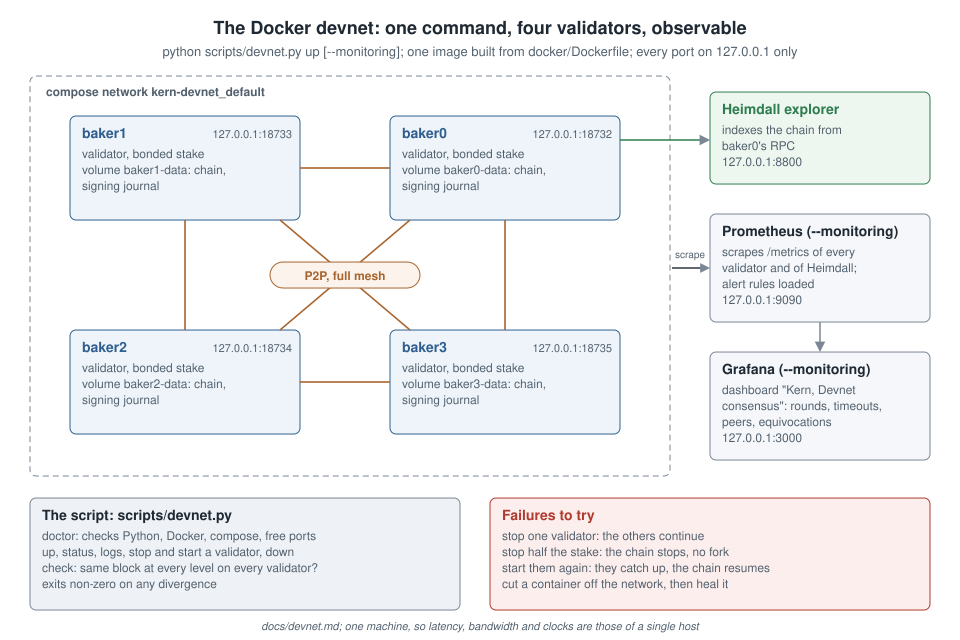

# Local multi-node devnet (Docker)

One command starts a Kern network of several validators on your machine, each in its own container with its own data volume and signing journal, connected over a real network, with the Heimdall explorer indexing the chain. Prometheus and Grafana can be added. It is the quickest way to try the repository, and the rehearsal for a multi-machine devnet: the same image, the same commands and the same metrics.

> **What it proves, and what it does not.** Every validator is a separate process in a separate container, but all run on one machine, operated by one person. It exercises consensus, peer connections, crashes and network cuts for real; it is not a network of independent operators, and not an audit.

## Requirements

- Docker with the compose plugin, and its engine running. On Windows and macOS, Docker Desktop.
- Python 3.11 or later with the repository's requirements: the launcher generates keys and the genesis on your machine.

`python scripts/devnet.py doctor` checks all of it (Python, packages, Docker, compose, engine, free ports) and gives, for each missing piece, the command for your platform. On an interactive terminal it offers to run that command and waits for a yes: `winget install -e --id Docker.DockerDesktop` on Windows, `brew install --cask docker` on macOS, `pip install -r requirements.txt` for the packages. On Linux it points to the official installation page for your distribution. It never installs anything without asking. `up` runs the same checks first and writes nothing until they pass.

## Start, watch, stop

From the repository root (Linux, macOS, or Windows PowerShell):

```bash
python scripts/devnet.py doctor              # is everything there? offers to fix what is missing
python scripts/devnet.py up                  # 4 validators + Heimdall
python scripts/devnet.py up --monitoring     # + Prometheus and Grafana
python scripts/devnet.py status              # head of every validator
python scripts/devnet.py check               # same block at every level?
python scripts/devnet.py logs baker0         # -f to follow
python scripts/devnet.py down                # stop, keep the chain
python scripts/devnet.py down --reset        # stop and delete the chain and keys
```

`up` generates `networks/devnet/` on first use (validator keys, faucet, genesis, `docker-compose.yml`, and `prometheus.yml` with `--monitoring`), builds one image from `docker/Dockerfile`, starts every service and waits until all validators have finalized a few blocks. `--validators N` chooses the size of a new devnet; to change the size or add monitoring later, use `up --regenerate` (this deletes the chain). The generated directory is ignored by git: its keys are public test keys, never to be used anywhere else.

| Service | Address (this machine only) |
|---|---|
| Validator RPC | `http://127.0.0.1:18732` for baker0, `18733` for baker1, and so on |
| Heimdall explorer | `http://127.0.0.1:8800` |
| Prometheus (`--monitoring`) | `http://127.0.0.1:9090` |
| Grafana (`--monitoring`) | `http://127.0.0.1:3000`, `admin` / `admin`, dashboard "Kern — Devnet consensus" |

Every port is published on `127.0.0.1` only. Inside the containers the RPC listens on every interface (`--rpc-bind 0.0.0.0`) so that the published port reaches it; peer-to-peer traffic stays on the compose network.



*Figure 1 (`docs/figures/devnet.svg`, original). Four validator containers, each with its own volume and signing journal, in a full peer to peer mesh; Heimdall reads baker0; Prometheus and Grafana with --monitoring. Every port is published on 127.0.0.1 only.*

## Exercising failures

```bash
python scripts/devnet.py stop baker2         # one validator down: the others continue
python scripts/devnet.py stop baker1 baker2  # half the stake down: the chain stops, no fork
python scripts/devnet.py start baker1 baker2 # they catch up and the chain resumes
python scripts/devnet.py check

# A network cut, then healing (the network is named kern-devnet_default):
docker network disconnect kern-devnet_default kern-devnet-baker3-1
docker network connect --alias baker3 kern-devnet_default kern-devnet-baker3-1
```

`check` compares the block of every validator at every level up to the lowest head, skips validators that do not answer, and exits with a non-zero status on any divergence, so it can run in a script after each experiment.

## What to watch

Each validator exposes Prometheus metrics on its RPC port (`/metrics`); Heimdall on its own (`/metrics`). The dashboard "Kern — Devnet consensus" (`kern_explorer/monitoring/grafana/devnet-consensus.json`) shows:

| Metric | Meaning |
|---|---|
| `kern_chain_height` | Head level, per validator. The spread between validators should stay within a few blocks (scrapes are not simultaneous). |
| `kern_consensus_round`, `kern_consensus_level` | Round in progress at the level being decided. 0 when levels finalize in their first round. |
| `kern_consensus_last_finalized_round` | Round in which the last block was finalized; above 0 when the first round failed (proposer down, slow network). |
| `kern_consensus_round_timeouts_total` | Rounds that ended without a block. |
| `kern_peers_connected` | Open peer connections, incoming and outgoing: 2(n − 1) for n fully meshed validators. |
| `kern_blocks_produced_total`, `kern_blocks_applied_total` | Blocks this validator proposed that were finalized; blocks appended to its chain. |
| `kern_consensus_proposal_evidence`, `kern_consensus_vote_equivocations_total` | Equivocation evidence kept or reported: 0 on an honest devnet. |
| `kern_chain_head_level` (Heimdall) | Last block indexed by the explorer. |

The alert rules of `kern_explorer/monitoring/alerts/kern-alerts.yml` are loaded too.

## Known limits

- **Dead peers.** A connection to a peer that vanished without closing it (machine off, network cut) stays counted until the operating system gives up on it. Configured peers are tried again every 5 seconds once their connection closes. A multi-machine network will need an application-level keepalive.
- **Transaction counters.** `kern_transactions_applied_total` and `kern_transactions_rejected_total` are counted when a block is applied, which also happens when a proposal is validated: on a network, most transactions are counted twice. The block counters and gauges are counted once, when a block is appended.
- **One machine.** Latency, bandwidth and clock drift are those of a single host.

## What it found the first time it ran

The first real run (8 November 2026) found faults that the unit tests did not see, each now covered by a test: every node exited at once (the compose command was split into words), Heimdall stopped after one block and stored blocks without their hash, peer counts were always 0 and failed peer connections were never retried, chain metrics ran one block ahead and histograms were added up twice, and the alert rules stopped Prometheus from starting. See [phase-e-changes.md](phase-e-changes.md).
